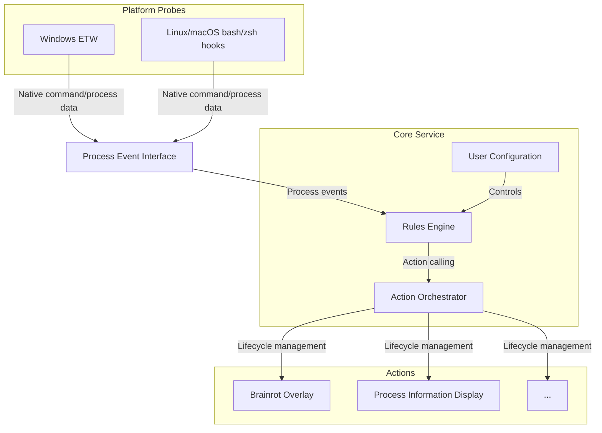

# VibeRot

Some commands take forever to run, and here you have the goated brainrot injector that turns your boring waits into endless doomscrolling sessions. Autoplay TikTok slop, Instagram reels, or whatever degenerate feed you crave, right on top of your screen.

[](https://github.com/endernoke/viberot)
[](https://github.com/endernoke/viberot)
(linux/macOS)

[](https://github.com/endernoke/viberot)

https://github.com/user-attachments/assets/f7010183-602e-4f7a-a94f-7fc94571054d

VibeRot is a background service that sniffs out slow ahh commands like `docker build` or `npm install` and blasts an overlay of pure brainrot. Watch the slop flow until your command finishes, then it will put the fries in the bag. No more productivity guilt; just blissful scrolling. You will never have to go touch grass while waiting for deployment or compilation again.


The service hooks into OS process or shell command creation, matches your rules, and spawns actions like the overlay. Actions run in parallel and auto-kill when your command wraps up.

## Installation

### Prerequisites
- Rust toolchain (you can install from [rust-lang.org/tools/install](https://rust-lang.org/tools/install/))
- Tauri prerequisites (optional but highly recommended): See [https://v2.tauri.app/start/prerequisites/#system-dependencies](https://v2.tauri.app/start/prerequisites/#system-dependencies)

### Building and Installation

> [!CAUTION]  
> On Windows, VibeRot requires admin privileges to monitor system processes. Make sure to run the service with the necessary permissions. Windows builds will prompt for elevation when run.

1. Clone the repo:
   ```bash
   git clone https://github.com/endernoke/viberot
   cd viberot
   ```

2. Build the core and the brainrot overlay:
   ```bash
   cargo build --release  # Core service
   cd actions/overlay
   cargo build --release  # The brainrot window
   cd ../..
   ```

   This may take a while, fortunately this will be the last time you have to endure the pain of waiting for commands to complete. Spend this time wisely.

   Executables will drop here:
   - Windows: `target\release\viberot-service.exe` (and `actions\overlay\target\release/viberot-overlay.exe` for the overlay)
   - Linux/macOS: `target/release/viberot-service` (and `actions/overlay/target/release/viberot-overlay` for the overlay)

4. Fire up the service manually:
   - For Linux/macOS, run:
      ```bash
      ./target/release/viberot-service
      ```
   - For Windows, either run the executable with the GUI, or open an **elevated terminal (Run as Administrator)** and run:
      ```bash
      .\target\release\viberot-service.exe
      ```
      The command will immediately return control to the terminal, and you're free to close the elevated terminal now.

5. Follow any on-screen instructions to set up your shell (for Linux/macOS).

   After that, it'll run in the background and listen for command start/end events. You can leave this terminal running in the background. For auto-start on boot, set it up with Task Scheduler or your platform's service manager.

> [!TIP]  
> On Linux/macOS, you can allow the service to continue running after you close the terminal by using `nohup`:
> ```bash
> nohup ./target/release/viberot-service &
> ```

6. Exercise your newfound degeneracy

   Open a new terminal and run this anywhere:
   ```bash
   cargo build
   ```

   Now add/modify any slow commands you want to the config (see below).

## Configuration

Config lives in TOML at:
- Windows: `%USERPROFILE%/.viberot/config.toml`
- Linux/macOS: `~/.viberot/config.toml`

### Rules
Each rule matches a command pattern and triggers an action (only "exec" type for now: run an exe/script).

```toml
[[rules]]
command = "*cargo.exe build*"  # Glob pattern for the command
[rules.action]
type = "exec"                  # Run this bad boy
path = "path/to/your/rot.exe"  # Absolute, relative, or PATH-resolved
args = ["--arg1", "--arg2"]    # Optional args for extra flavor
single_instance = true         # Optional: No duplicate rot sessions, default false
```

You can refer to the comments in the default config [for Linux/macOS](rules/rules.toml) or [Windows](rules/rules.win.toml) for comprehensive documentation.

The default configuration includes rules that watch for the following commands:
- `cargo`
- `npm`, `yarn`, `pnpm`
- `pip`, `poetry`, `uv`
- `mvn`, `gradle`
- `docker build`
- `kubectl apply`
- `terraform apply`

and some others. Feel free to submit PRs to fix or expand this list.

> [!TIP]  
> **On Windows:**  
> Always use the full command line expansion for processes to watch, e.g. `*npm-cli.js* install*` instead of `npm install*`.
>
> **On Linux/macOS:**  
> Use whatever you type in the shell, `npm install` will be `npm install`.

### Path Resolution in Rules
- **Paths**: Absolute paths work as-is. Relative paths are from the project root (where `Cargo.toml` lives). Names without paths search the system PATH.
- **Env Vars**: Use `${VAR_NAME}` for expansion. Built-ins: `${VIBEROT_HOME}` (project root), `${VIBEROT_ACTIONS}` (actions dir). System vars like `${USERPROFILE}` work too.

Actions receive these environment variables:
- `VIBEROT_COMMAND`: Full command line
- `VIBEROT_TIMESTAMP`: When the process started (Unix timestamp)
- `VIBEROT_HOME`: Project root path
- `VIBEROT_PID`: ID of the process being watched (**CAUTION**: see [docs/synthetic-pids.md](docs/synthetic-pids.md))

## Bundled VibeRot Actions

In `actions/`, we've got premade degeneracy:

### Brainrot Overlay (`actions/overlay/`) – The magnificant star of the show
Cluely but for brainrot: a Tauri-based, see-through window for unlimited slop:
- Autoplays TikTok (default), but swap to Instagram, Reddit, X, or your fave rot site.
- Transparent and always-on-top
- Closes automatically when your command finishes

Check [actions/overlay/README.md](actions/overlay/README.md) for details.

> [!TIP]  
> Want to scroll reels directly from your terminal? Check out [reels-cli](https://github.com/notMarkMP1/reels-cli) (not affiliated).

### Debug Display (`actions/example/`)
A simple Python/Tkinter GUI showing process info. Great for testing rules or hacking your own actions.

VibeRot is customizable af. You can easily create your own actions in any language that can be executed from the command line. Just make sure your action can handle stdin closing to know when to exit if needed.

You can even make actions to do something *actually productive* while you wait, like opening the unsloth.ai docs or launching a quick leetcode practice in a browser, but this energy isn't encouraged.

Feel free to open PRs that add links here to your own actions.

## Under the Hood: How VibeRot Works

VibeRot is built in Rust for speed and aura farming purposes.

> [!WARNING]
> I vibe-coded 90% of this. I tried to review everything but I still have no idea how the borrow checker works 💀😭 Please forgive any sins I made and raise them in issues if you find any.

### Architecture



- **Core service**: Loads config, matches rules, spawns actions.
- **Platform probes**:
   - On Windows, uses ETW (event tracing for Windows). This achieves system-wide process monitoring. (I believe) it wraps the Windows API directly in Rust.
   - On Linux/macOS, uses bash/zsh pre and post-command hooks to watch for command execution. The hooks send data to a Unix socket to communicate with the core service.
- **Actions**: Actions run as independent child processes, and get notified on command exit via stdin close.

### Flow
1. OS detects new process.
2. Service checks rules.
3. If a match is found, ~swipe right~ spawn action in parallel.
4. The stdin of the child process is closed when the watched command exits, signaling the action to clean up.

## Contributing

Contributions are welcome! Here's how to get started:

1. Pay your fanum tax by starring the repo, it means a lot :>
2. Fork the repository
3. Create a feature branch
4. Make your changes and make sure nothing breaks
5. Open a Pull Request with a clear description of your changes (bonus points if it's written in Gen Z/alpha slang)
6. 7

For changes requiring significant design decisions, please open an issue first to discuss your ideas.

Apart from code contributions, you can also help by:

- Reporting bugs and suggesting features
- Testing with different setups and platforms
- Expanding the default config to watch for more long-running commands
- Improving documentation

## License

We firmly believe degeneracy is a fundamental human right and should be free and accessible to all. VibeRot is open source under the MIT License. See [LICENSE](LICENSE).

## Credits

Shoutout to [Jet](https://github.com/supreme-gg-gg) for coming up with the based idea of autoplaying reels while waiting for commands to complete.

Also check out this somewhat related project: [gifi](https://github.com/vadimdemedes/gifi).

Author: [James Zheng](https://github.com/endernoke)